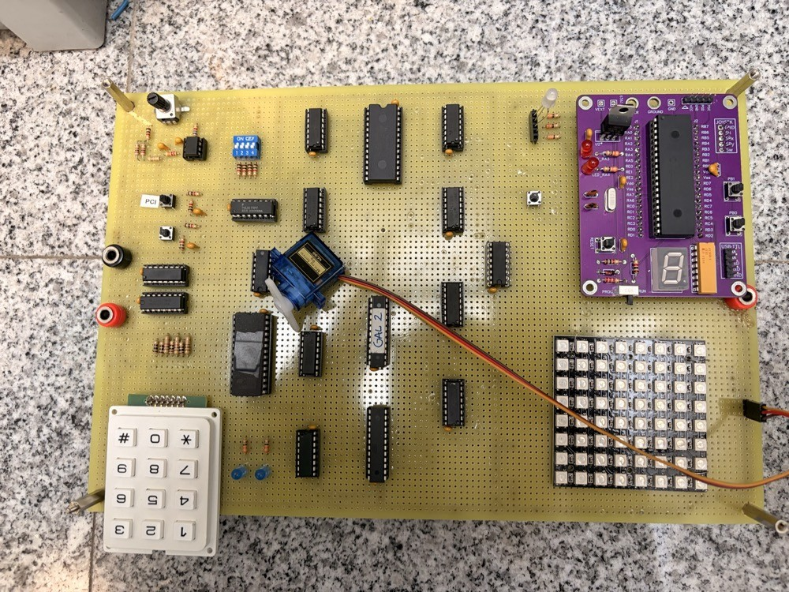

# LSTamagotchi · Fase 2

Firmware en ensamblador para un PIC18F4321 que controla una mascota virtual en una placa física. Proyecto académico de Sistemas Digitales y Microprocesadores en La Salle Campus Barcelona, desarrollado por **Jofre Tura Centelles y Guillem Gil**.

## Funcionamiento

- Tres pulsadores con antirrebote por software permiten jugar, alimentar a la mascota o reiniciar el sistema. Un LED RGB indica la opción seleccionada.
- El Timer0 marca el ritmo de los contadores de edad y hambre y del PWM del servomotor. La matriz LED representa el estado de salud y la edad.
- Un bus digital de cuatro bits y señales de control sincronizan el firmware con el juego de memoria de la fase 1. La fase 2 envía los valores, espera el resultado y concede tokens de comida cuando se gana una partida.
- La rutina de interrupción agrupa los cambios de edad y salud antes de redibujar la cara en la matriz LED.

## Abrir y compilar

Descarga y descomprime [el código y la configuración del proyecto](lstamagotchi-fase-2.zip).

1. Abre `Fase2_2026.X` como proyecto existente en una versión de MPLAB X compatible con MPASM. La configuración original usa MPASM 5.86 y el dispositivo `PIC18F4321`.
2. Selecciona el ensamblador MPASM instalado y la configuración `default`. El archivo principal es `Fase2_2026.X/codi_P1F2.asm` y utiliza el archivo de cabecera `p18f4321.inc` del ensamblador.
3. Ejecuta **Clean and Build** desde MPLAB X para generar los archivos locales y el firmware. Para ejecutar el juego de memoria completo, conecta la placa de la fase 1 al bus y a las señales correspondientes.

El proyecto conserva la sintaxis de MPASM. MPLAB X 5.40 y posteriores requieren adaptar el código para usar el ensamblador PIC de XC8. [Compatibilidad de herramientas de Microchip](https://developerhelp.microchip.com/xwiki/bin/view/software-tools/ides/x/compiler-req/).

La entrega académica documenta las pruebas con el prototipo. En esta revisión se verificaron la integridad del código y las referencias del proyecto. La recompilación con MPASM y las pruebas sobre placa quedan pendientes.
